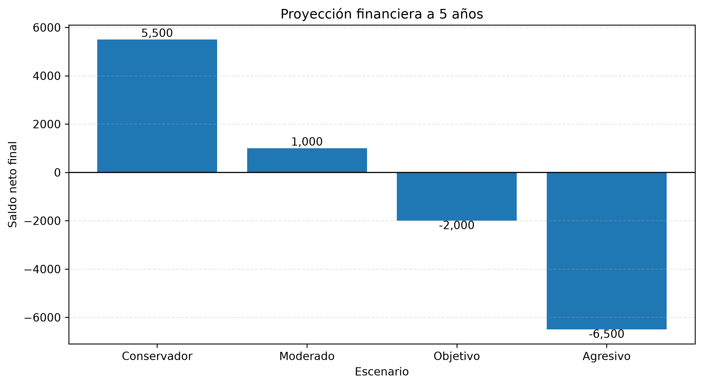
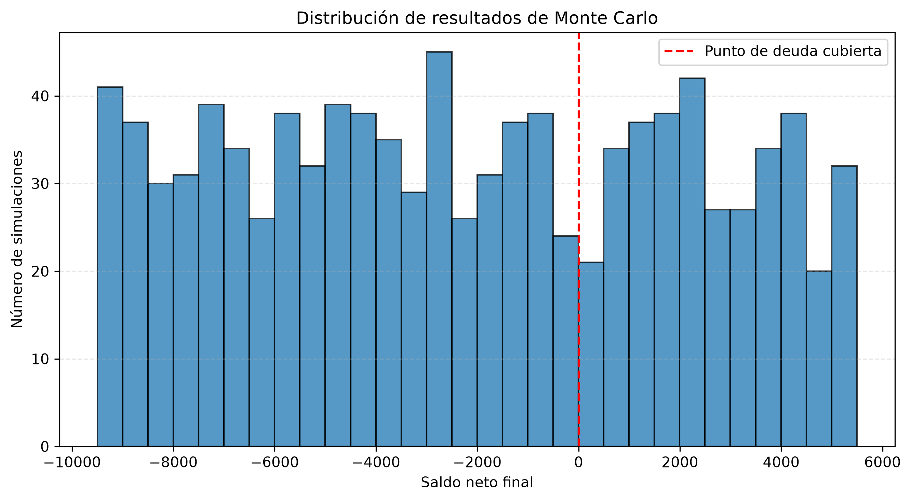

# Futuros Posibles: decisiones basadas en datos

Proyecto demostrativo de ciencia de datos que utiliza escenarios financieros, simulación de Monte Carlo y análisis de sensibilidad para explorar resultados hipotéticos a cinco años.

Todos los valores utilizados son sintéticos y tienen fines exclusivamente ilustrativos. Este proyecto no contiene información real de clientes.

## Objetivos

- Comparar distintas estrategias hipotéticas de ahorro mensual.
- Simular 1.000 posibles resultados financieros bajo supuestos definidos.
- Analizar cómo los niveles de ahorro afectan el saldo neto al final del período.
- Demostrar el uso de Python para realizar análisis reproducibles.

## Metodología

### 1. Análisis de escenarios

Compara cuatro estrategias hipotéticas de ahorro mensual: conservadora, moderada, objetivo y agresiva.



### 2. Simulación de Monte Carlo

Realiza 1.000 simulaciones con valores de ahorro mensual seleccionados aleatoriamente entre 0 y 250 unidades monetarias. Se utiliza una semilla fija para facilitar la reproducción de los resultados.



### 3. Análisis de sensibilidad

Evalúa cómo diferentes cantidades fijas de ahorro mensual afectan el saldo neto final al cabo de cinco años.

## Tecnologías utilizadas

- Python
- `random`
- `statistics`

El proyecto utiliza módulos incluidos en la biblioteca estándar de Python, por lo que no requiere instalar paquetes externos.

## Cómo ejecutar el proyecto

**Requisito:** Python 3.10 o una versión posterior.

1. Descarga o clona el repositorio.
2. Abre una terminal en la carpeta del proyecto.
3. Ejecuta:

```bash
python simulation.py
```

El programa muestra en la terminal los resultados del análisis de escenarios, la simulación de Monte Carlo y el análisis de sensibilidad.

## Supuestos y limitaciones

- La deuda inicial utilizada es sintética y se establece en 5.500 unidades monetarias.
- El período analizado es de cinco años.
- En los escenarios fijos, el ahorro mensual permanece constante.
- En la simulación de Monte Carlo, el ahorro mensual se selecciona uniformemente entre 0 y 250 unidades monetarias.
- No se modelan intereses, inflación, comisiones ni cambios en los ingresos.
- El saldo final se calcula restando el ahorro acumulado a la deuda inicial; no representa un calendario real de amortización con intereses.
- Los resultados dependen de los supuestos del modelo y no constituyen predicciones sobre la situación financiera de una persona.

## Uso responsable

Este proyecto tiene fines educativos y de demostración de habilidades en ciencia de datos. No constituye asesoramiento financiero.

## Conclusiones

Este proyecto demuestra cómo Python puede utilizarse para explorar escenarios financieros hipotéticos mediante análisis de escenarios, simulación de Monte Carlo y análisis de sensibilidad.

Los principales aprendizajes del ejercicio son:

Comparación de estrategias: analizar diferentes niveles de ahorro mensual permite observar cómo las decisiones de ahorro afectan el saldo neto al final del período estudiado.

Incertidumbre y variabilidad: la simulación de Monte Carlo permite explorar una variedad de resultados posibles bajo los supuestos establecidos, en lugar de depender de un único escenario.

Análisis de sensibilidad: comparar distintos valores de ahorro ayuda a identificar cómo cambia el resultado final cuando se modifica una variable del modelo.

Importancia de los supuestos: los resultados dependen de las condiciones definidas en la simulación. La ausencia de intereses, inflación, comisiones y variaciones de ingresos limita su aplicación a situaciones reales.

En conclusión, el proyecto ilustra cómo las herramientas de ciencia de datos pueden apoyar la exploración y comparación de decisiones financieras. Los resultados son educativos y no constituyen predicciones ni recomendaciones financieras personales.

Como posible mejora futura, el modelo podría ampliarse para incorporar tasas de interés, inflación y variaciones en los ingresos, permitiendo estudiar escenarios más cercanos a situaciones financieras reales.

## Autoría

Proyecto independiente de portafolio de ciencia de datos.
